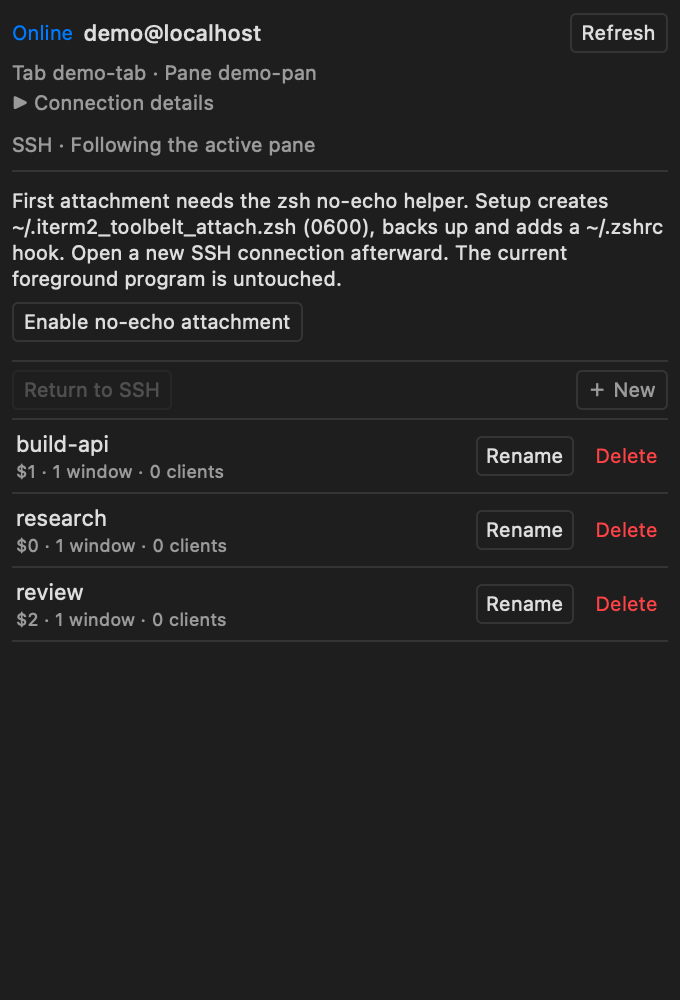
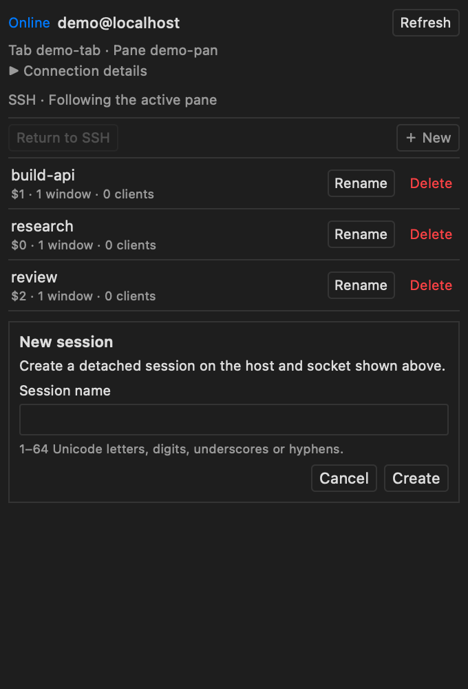
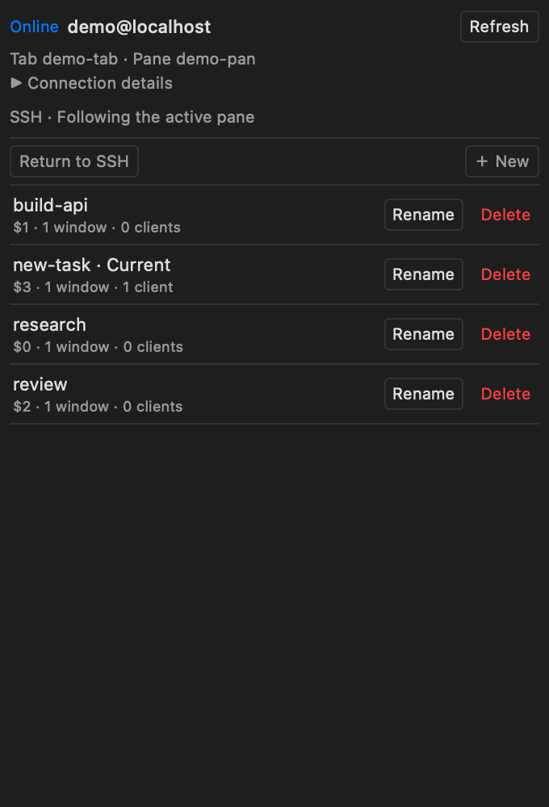
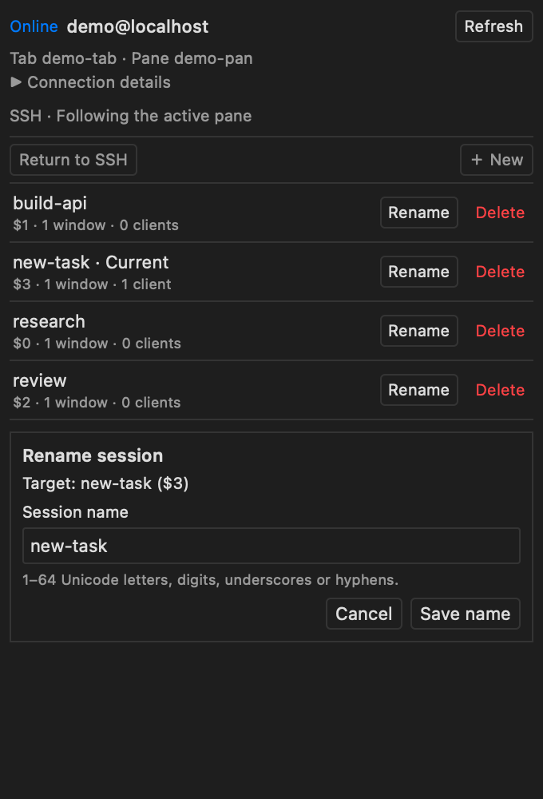
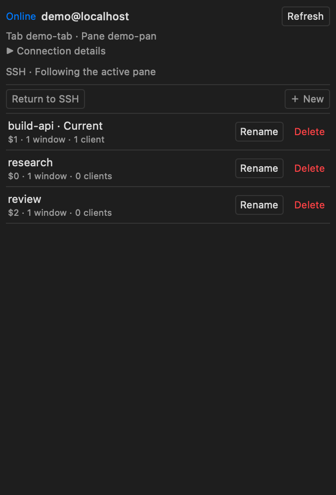
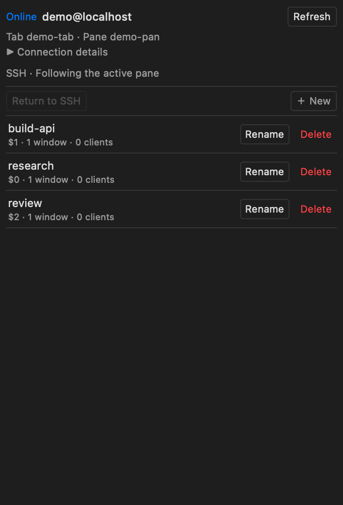
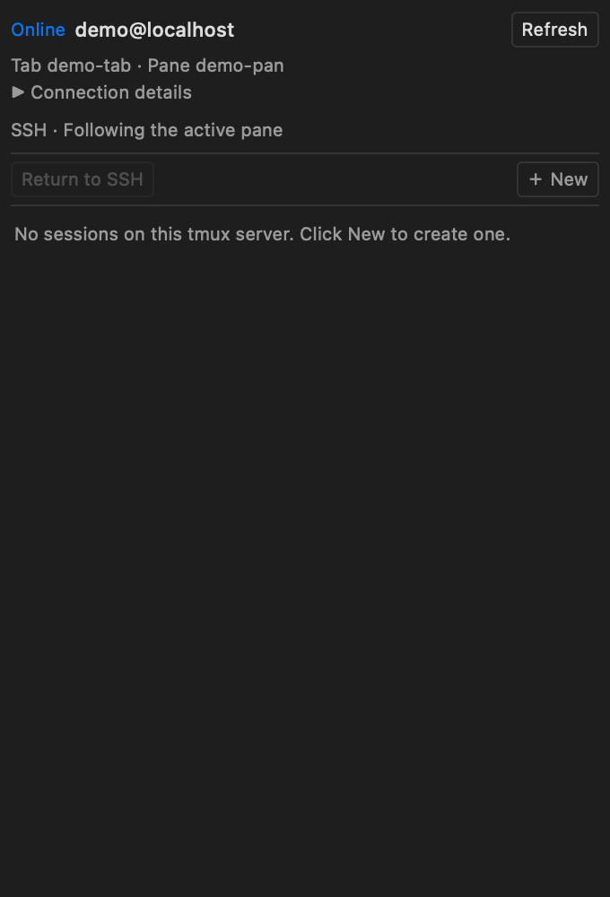

# iTerm2 tmux Toolbelt

**English** | [简体中文](README.zh-CN.md)

Manage tmux sessions on the machine connected to your active iTerm2 tab, from a compact Toolbelt sidebar. Click to switch, create a detached session, rename, delete, or return to the original SSH shell while keeping tmux tasks running.


The interface follows your macOS/WebView preferred language: Chinese uses Simplified Chinese; other languages use English. It also follows iTerm2's light/dark appearance and macOS semantic colors. Reopen the panel after changing system language. Native behind-window translucency is [limited by the host WebView API](docs/THEME.md).

The screenshots are actual native WKWebView captures of this product page, backed by real, isolated local tmux sessions. Host/focus metadata comes from an anonymous demonstration adapter; they illustrate the interface, not a production SSH connection. No user terminal, private address, credential or task is shown. See [capture provenance](docs/screenshots/README.md).

## Requirements

| Component | Requirement |
| --- | --- |
| Mac | macOS with iTerm2 **3.7.4**; other builds have not been accepted |
| Python | iTerm2's official Python Runtime; tested with Python **3.12.13 / SDK 2.30** |
| SSH | A unique foreground macOS `/usr/bin/ssh` connection; verified host key and noninteractive key/agent or reusable ControlMaster authentication |
| Target host | tmux; first attachment in the same pane requires interactive **zsh** plus the opt-in integration/helper below |
| Tested tmux | **3.4** on Linux and **3.6a** in disposable integration tests |

The Mac does **not** need tmux to run the plugin. A local tmux binary is only needed for development tests and screenshot capture. The plugin has no Python dependencies beyond the official `iterm2` SDK and standard library.

## Install

1. Download `iterm2-tmux-toolbelt-v0.0.1.zip` and `SHA256SUMS.txt` from [v0.0.1](https://github.com/W-guofeng/iterm2-tmux-toolbelt/releases/tag/v0.0.1). Check the ZIP's SHA-256 against that file, then extract it.
2. In iTerm2, open **Scripts → New Python Script → Basic** to initialize the official Python Runtime if needed. Approve a Runtime download yourself. If the dialog requires a temporary script name, use a name other than `tmux_toolbelt`; the temporary script does not need to run.
3. Enable **Settings → General → Magic → Enable Python API** yourself, and approve iTerm2's script-access prompt when shown. The installer cannot approve either permission.
4. From the extracted folder, preview and install using Python 3.9+:

   ```sh
   python3 scripts/install.py
   python3 scripts/install.py --confirm
   ```

   The installer copies only the bundled script to `~/Library/Application Support/iTerm2/Scripts/tmux_toolbelt.py`. It refuses unknown existing files and symlinks. It does not run the plugin, enable API access, or configure AutoLaunch.
5. Choose **Scripts → tmux_toolbelt**. If the panel is hidden, choose **View → Show Toolbelt**, then **Toolbelt → tmux Sessions**. Startup also attempts to reveal it; a duplicate launch reveals the existing instance.

The single-file `tmux_toolbelt.py` release asset is available for advanced manual installation. The ZIP installer is recommended because it checks existing files. For a separate development runtime, see [testing](docs/TESTING.md).

AutoLaunch is optional: stop/uninstall the manual copy first, then preview `python3 scripts/install.py --autolaunch` and add `--confirm` only if you want it to start with iTerm2. Do not install both copies.

## Connect and configure once

Connect normally with `ssh your-host`. The sidebar follows the active pane in the foreground iTerm2 window, identifies its actual SSH process and queries that remote user. It never guesses a host from the tab title or falls back to local tmux.

Listing and detached creation need only tmux and usable noninteractive SSH authentication. **First attachment also needs verified idle-shell metadata and the no-echo helper.** If missing, the sidebar explains the changes and offers these explicit buttons:

1. **Set up shell integration** copies the checksum-verified official script from your installed iTerm2 app. It backs up and adds startup hooks for Linux bash/zsh. No network download or sudo is used.
2. On zsh, **Enable no-echo attachment** adds `~/.iterm2_toolbelt_attach.zsh` (0600), backs up `~/.zshrc`, and adds its load hook once. A known older helper instead gets **Repair tmux display**. Customized files and symlinks are refused.
3. **Open a new SSH connection** to load the changes. Existing shells are never sourced automatically; current tasks can stay running. If you need both setup steps, reconnect when the panel requests it, then complete the next offered step.



Configuration uses the already verified SSH route and changes only your own startup/integration files. Backup locations appear in the local receipt. Runtime inboxes are private (0700 directories, 0600 data files). No remote Python, daemon, password storage or public listening port is required. Startup control flow, custom `ZDOTDIR`, unsupported shells or key-binding conflicts may require manual review.

A password typed into a nonmultiplexed SSH connection cannot be reused by the separate query channel. Configure authentication yourself if querying is offline; the plugin does not change credentials, SSH settings or host keys.

## Use the sidebar

| Action | Result |
| --- | --- |
| Automatic list | Sessions belong to the active SSH host and selected tmux socket. Details identify the tab/pane, server and bound client. |
| **New** | Creates a detached session and adds it to the list. It does not attach or create a split/window. |
| Click a session | First attaches from the original, verified empty SSH prompt; later clicks switch that exact client in the same pane/tab. |
| **Rename** | Changes the exact session's name. Names allow 1–64 Unicode letters/digits, `_` and `-`. |
| **Delete** | **Immediate, without confirmation. Terminates every task in that session.** The separate button does not select the row. |
| **Return to SSH** | Detaches the bound client and resumes the original SSH shell; sessions and their tasks remain. |

| Create a detached session | Switch in the same pane |
| --- | --- |
|  |  |

| Rename | After direct deletion |
| --- | --- |
|  |  |

| Return to SSH; sessions remain | No sessions yet |
| --- | --- |
|  |  |

When several sockets exist, select one in **Connection details**. Discovery covers the remote user's standard `/tmp/tmux-UID/` and `TMUX_TMPDIR` directories; a custom absolute path can be selected explicitly. The list covers one socket at a time. Return to SSH before changing it. Disconnects clear the list and disable actions; **Refresh** can reconnect querying. Mutations never replay automatically.

Running Claude or partially typed input is protected: first attachment is refused unless the original pane is at a matching idle, empty prompt. Once the sidebar has bound its tmux client, switches and management use the separate control channel. To bind an already manually attached client, detach to the SSH prompt once and click a session in the sidebar.

## Troubleshooting

| Symptom | Check |
| --- | --- |
| Panel absent | Enable the Python API; start the script from Scripts; show Toolbelt and select tmux Sessions. Check **Scripts → Manage → Console**. |
| SSH query offline | Verify the displayed target, host key, tmux installation and key/agent or ControlMaster authentication. No password prompt is expected. |
| First click refused | Complete the offered integration/helper steps, reconnect SSH, and use an idle empty zsh prompt. Do not remove identity checks. |
| Session changes but output does not | Use **Repair tmux display**, then open a new SSH connection. Old live shells retain the old helper until replaced. |
| More than one socket | Select the intended socket in Connection details. |
| Return to SSH refused | Check the session's `destroy-unattached` policy. The plugin refuses a known destructive policy instead of changing it. |
| Plugin restarted while attached | The new instance does not take over an unverified client. Detach manually to SSH, then click to bind again. |
| Stuck/offline script | Check the private rotating log below; restart only this plugin in Scripts Console. Keep iTerm2 and remote jobs running. |

Log: `~/Library/Logs/iterm2-tmux-toolbelt/toolbelt.log` (directory 0700, files 0600, two rotated backups). Events contain stages, error codes and session IDs, without hosts, session names, commands, keys or access tokens. Review any diagnostics before sharing. The authenticated health endpoint does not query SSH. Slow state requests have bounded deadlines; API recovery is limited and does not repeat actions.

Do not share the registered panel URL: iTerm2 may retain its temporary fragment token in preferences/diagnostics. HTTP listens only on a random `127.0.0.1` port and requires the in-memory token plus same-origin action requests.

## Update and uninstall

Stop **only this plugin** in Scripts Console; do not quit iTerm2 or kill remote tasks. From a new release folder:

```sh
python3 scripts/install.py --update
python3 scripts/install.py --update --confirm
```

Start the updated script from Scripts. To uninstall:

```sh
python3 scripts/install.py --uninstall
python3 scripts/install.py --uninstall --confirm
```

Add `--autolaunch` only for an existing AutoLaunch installation. The installer handles only marked project scripts. Hiding/stopping/uninstalling does not delete tmux sessions; iTerm2 may retain the tool menu registration because its public SDK has no unregister API.

To remove remote setup, review the recorded backups. Remove the helper's load line from `~/.zshrc` and its file, or restore/merge the matching backup. Remove official integration only if nothing else uses it. Preserve later edits; never blindly restore over them. Existing loaded shells can exit naturally.

## Known limits

- Initial same-pane attachment requires interactive remote **zsh**; bash supports listing/detached management, with no command-text fallback.
- Automatic detection accepts system OpenSSH and the verified iTerm2 3.7.4 native SSH Profile wrapper. mosh, nested SSH, arbitrary wrappers/remote commands and ambiguous routes are refused.
- Existing **`tmux -CC`** uses the native control connection. Its window/tab mapping is owned by iTerm2, so that path does not promise original-pane reuse.
- Tasks persist only according to tmux/server policies; host reboots, task exits and administrator actions can end them. Direct deletion intentionally ends tasks.
- Terminal Profile transparency does not make the opaque Toolbelt WebView translucent. Theme/semantic colors are supported; native behind-window material is not.
- Public screenshots use the documented demo adapter. Tests distinguish unit adapters, isolated tmux/SSH, native WebKit and real iTerm2 SDK evidence; see [testing](docs/TESTING.md).

## Development and license

[Testing](docs/TESTING.md) · [Architecture](docs/ARCHITECTURE.md) · [Contributing](CONTRIBUTING.md) · [Release notes](CHANGELOG.md)

Project-authored code: [Apache-2.0](LICENSE). External components retain their own licenses; see [THIRD_PARTY.md](THIRD_PARTY.md). This is an independent extension, not an official iTerm2 project.
