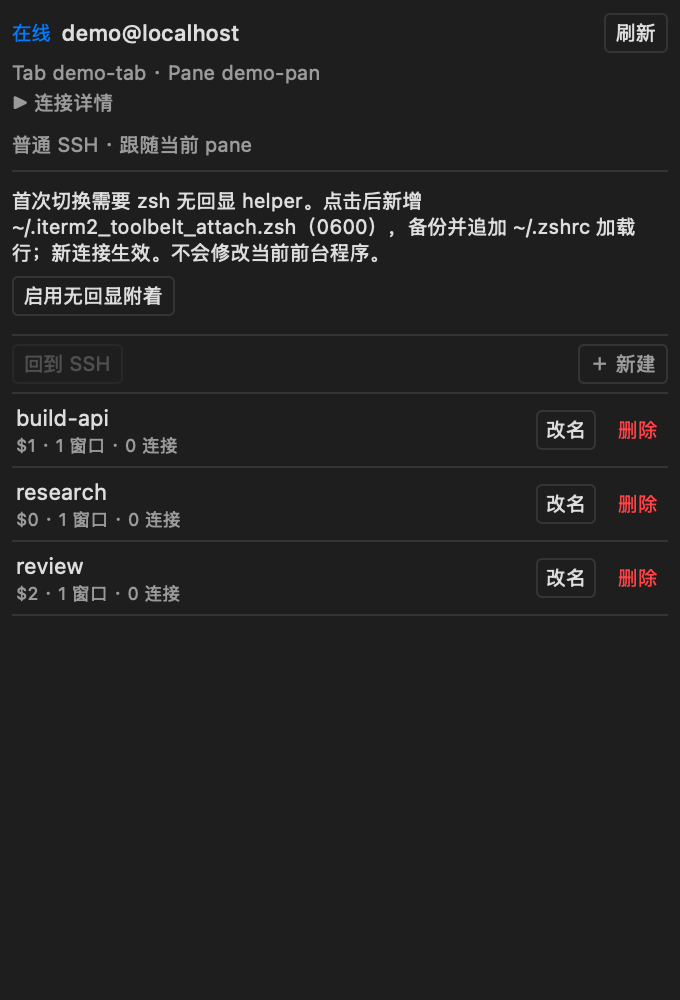
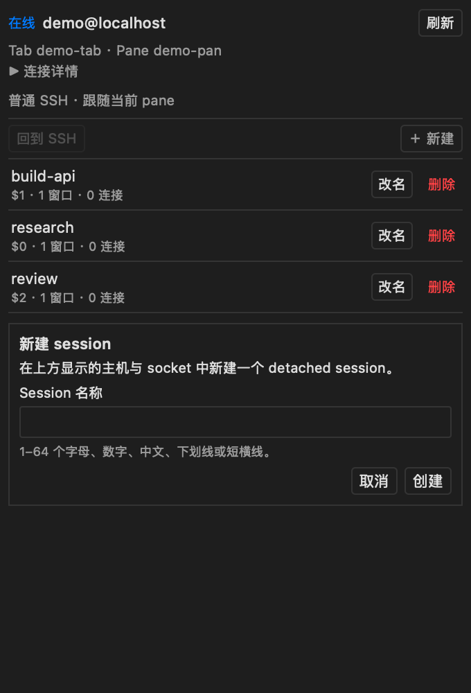
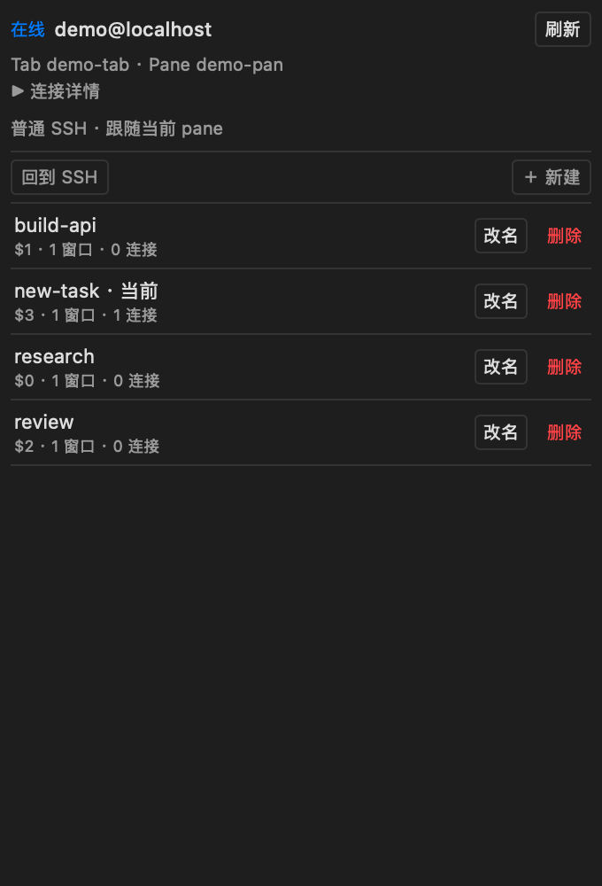
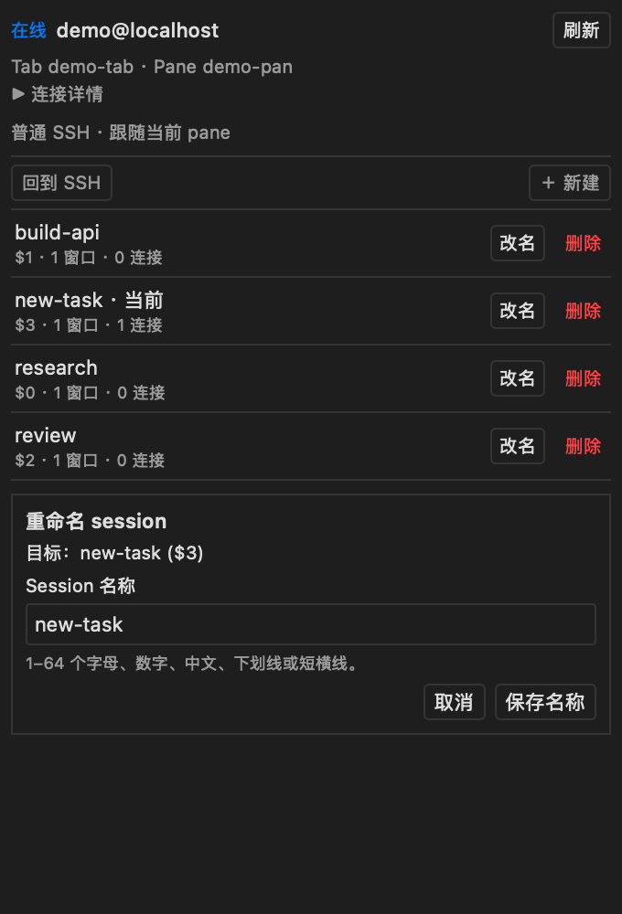
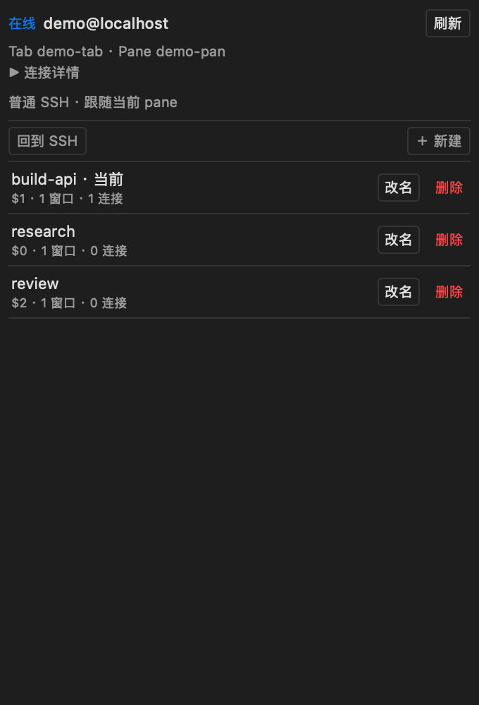
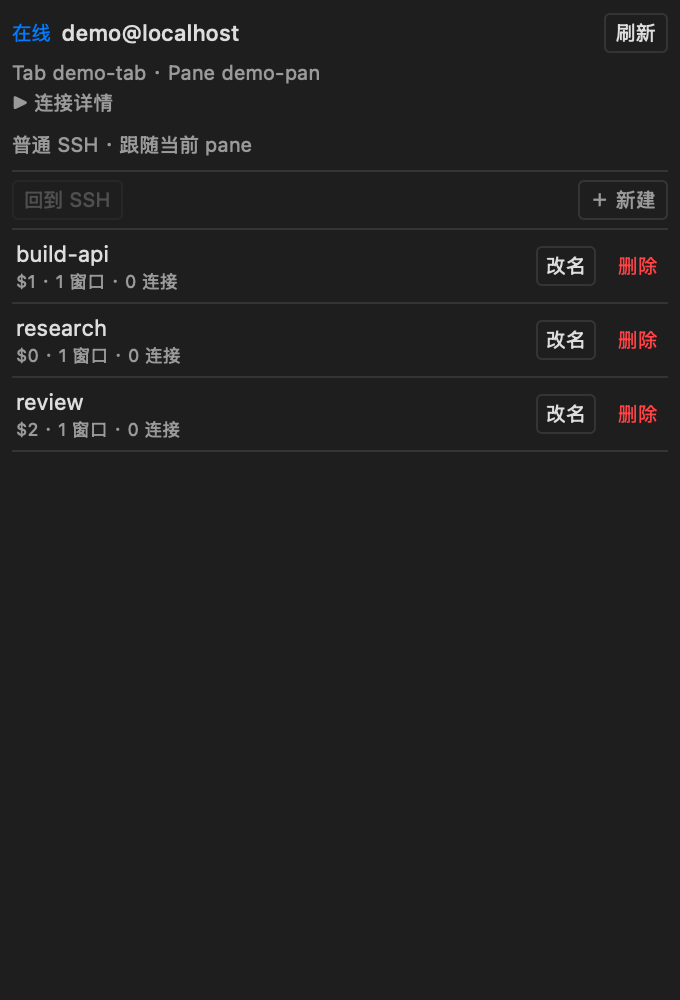
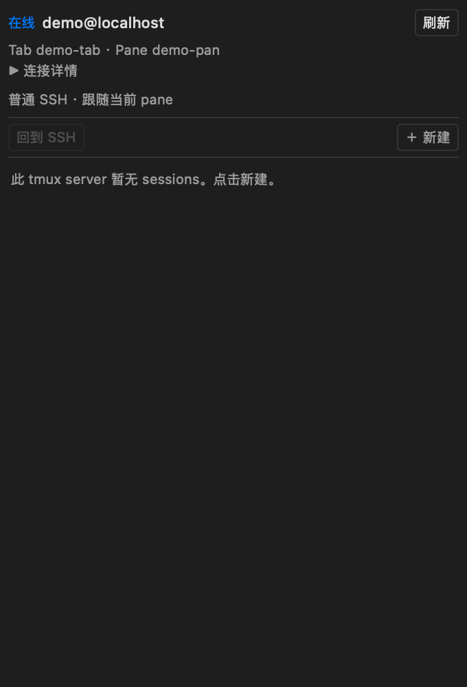

# iTerm2 tmux Toolbelt

[English](README.md) | **简体中文**

在 iTerm2 Toolbelt 侧栏管理当前活动 tab 所连接机器的 tmux sessions：鼠标切换、新建、重命名、直接删除，以及回到原 SSH shell。分离后 tmux 中的任务继续运行。


界面自动跟随 macOS/WebView 的首选语言：中文使用简体中文，其他语言使用英文；同时跟随 iTerm2 深浅主题和 macOS 系统语义色。修改系统语言后重新打开面板即可。原生窗口背后的半透明材质仍受 [宿主 WebView API 限制](docs/THEME.md)。

文档截图来自本产品页面的真实原生 WKWebView，背后使用隔离的本机 tmux 会话。主机/焦点元数据由匿名演示适配器提供，用于展示界面，不代表生产 SSH 连接。没有截取用户终端、私人地址、凭证或任务。详见 [截图来源与复现](docs/screenshots/README.md)。

## 前置条件

| 组件 | 要求 |
| --- | --- |
| Mac | macOS 与 iTerm2 **3.7.4**；其他构建尚未验收 |
| Python | iTerm2 官方 Python Runtime；已验证 **Python 3.12.13 / SDK 2.30** |
| SSH | 唯一可识别的前台 macOS `/usr/bin/ssh`；主机密钥已验证，密钥/agent 或 ControlMaster 可无交互认证 |
| 目标机器 | 已安装 tmux；首次在原 pane 附着还需要交互 **zsh** 和下文显式安装的集成/helper |
| 已验证 tmux | Linux **3.4**，以及隔离集成测试中的 **3.6a** |

运行插件不需要在 Mac 安装 tmux。本机 tmux 只用于开发测试和生成文档截图。除官方 `iterm2` SDK 外，Python 运行依赖均为标准库。

## 安装与启动

1. 从 [v0.0.1 发布页](https://github.com/W-guofeng/iterm2-tmux-toolbelt/releases/tag/v0.0.1) 下载 `iterm2-tmux-toolbelt-v0.0.1.zip` 和 `SHA256SUMS.txt`，核对 ZIP 的 SHA-256 后解压。
2. 如果尚未初始化官方 Python Runtime，在 iTerm2 选择 **Scripts → New Python Script → Basic**，自行确认 Runtime 下载。若对话框要求保存临时脚本，请使用 `tmux_toolbelt` 以外的名称；临时脚本不需要运行。
3. 自行开启 **Settings → General → Magic → Enable Python API**，运行脚本时按需确认 iTerm2 的 API 访问提示。安装器不能替你批准权限。
4. 在解压后的目录，使用 Python 3.9+ 预览并安装：

   ```sh
   python3 scripts/install.py
   python3 scripts/install.py --confirm
   ```

   只将打包脚本复制到 `~/Library/Application Support/iTerm2/Scripts/tmux_toolbelt.py`。未知同名文件和符号链接不会被覆盖；不会自动运行、开启 API 或配置 AutoLaunch。
5. 选择 **Scripts → tmux_toolbelt**。若侧栏没有出现，选择 **View → Show Toolbelt**，再选择 **Toolbelt → tmux Sessions**。启动时也会尝试显示；重复启动只显示已有实例。

发布页也提供单文件 `tmux_toolbelt.py`，供熟悉 Scripts 目录的用户手动安装；推荐 ZIP 安装器以保留文件检查。独立开发环境见 [测试说明](docs/TESTING.md)。

默认不自动启动。如确实需要，先停止并卸载手动副本，预览 `python3 scripts/install.py --autolaunch`，再加 `--confirm` 安装。不要同时保留手动和 AutoLaunch 两份。

## SSH 连接与一次性配置

照常执行 `ssh your-host`。侧栏跟随前台 iTerm2 窗口中的活动 pane，通过实际 SSH 进程识别机器和用户，不根据标题猜测，也不回退操作 Mac 本机 tmux。

列表和 detached 新建只需要 tmux 与可用的无交互 SSH 认证。**第一次附着还需要匹配的空闲 shell 信息与无回显 helper。** 缺少时，侧栏先解释变更，再提供明确按钮：

1. **一键配置远端集成**：从本机已安装的 iTerm2 复制哈希校验通过的官方脚本，备份并添加 Linux bash/zsh 的启动加载行。不下载远端脚本，不执行 sudo。
2. zsh 下提供 **启用无回显附着**：新增 `~/.iterm2_toolbelt_attach.zsh`（0600），备份 `~/.zshrc` 后只追加一次加载行。已知旧版提供 **一键修复 tmux 画面**；自定义文件和符号链接会拒绝覆盖。
3. **另开一个 SSH 连接**加载新配置。不会向旧 shell 自动输入 `source`，现有任务可以继续。如果两步都缺少，按侧栏提示重新连接，再完成下一步。



配置使用已验证的 SSH 路由，只修改当前用户自己的启动/集成文件，备份路径显示在本地回执。运行时临时目录为 0700、请求数据为 0600。远端不需要 Python、常驻服务、密码存储或公网监听。自定义 `ZDOTDIR`、复杂启动流程、不支持的 shell 或按键冲突可能需要手动检查。

只在某条未开启复用的 SSH 连接里输入过密码，无法让独立查询连接借用它。认证不足时请自行配置密钥/agent 或复用；插件不会修改凭证、SSH 设置或主机密钥。

## 侧栏操作

| 操作 | 效果 |
| --- | --- |
| 自动发现 | 显示活动 SSH 主机、选中 tmux socket 的 sessions；连接详情可核对 tab/pane、服务器及绑定客户端 |
| **新建** | 创建 detached session，只加入列表，不附着、不创建分屏或窗口 |
| 点击 session | 从原 pane 的已验证空闲且空输入提示符首次附着；之后在同 pane/tab 切换该准确客户端 |
| **改名** | 修改精确 session 的名称；支持 1–64 个 Unicode 字母/数字、`_` 和 `-` |
| **删除** | **立即执行，没有二次确认，会终止该 session 的所有任务**；独立按钮不会触发行切换 |
| **回到 SSH** | 分离绑定客户端，恢复原 SSH shell；session 和其中任务保留 |

| 创建 detached session | 在原 pane 切换 |
| --- | --- |
|  |  |

| 重命名 | 直接删除后的列表 |
| --- | --- |
|  |  |

| 回到 SSH，任务保留 | 空状态 |
| --- | --- |
|  |  |

多个 socket 时，在 **连接详情** 显式选择目标。默认发现远端本用户 `/tmp/tmux-UID/` 和 `TMUX_TMPDIR` 标准目录，也可手动指定绝对路径；一次只列一个 socket。更换前先回到 SSH。断线后清空列表并禁用操作，**刷新** 可重建查询连接；不会自动重放修改操作。

保护运行中的 Claude 和未完成输入：首次附着必须在匹配的空闲、空输入提示符，否则拒绝且不输入命令。绑定后，切换和管理走独立控制通道。若已经手动 `tmux attach`，先自行分离回 SSH，再从侧栏点击一次以建立准确绑定。

## 故障排查

| 现象 | 检查 |
| --- | --- |
| 找不到面板 | 开启 Python API，从 Scripts 启动，显示 Toolbelt 并勾选 tmux Sessions；查看 **Scripts → Manage → Console** |
| SSH 查询离线 | 核对目标、主机密钥、tmux、密钥/agent 或 ControlMaster；插件不会弹密码 |
| 第一次点击被拒绝 | 完成侧栏提供的集成/helper 配置，重新连接，使用空闲空输入的 zsh 提示符，不要取消身份校验 |
| 标记切换但没有画面 | 使用 **一键修复 tmux 画面** 后另开 SSH；旧连接仍保留已载入的旧函数 |
| 发现多个 socket | 在连接详情选择明确目标 |
| 无法回到 SSH | 检查 `destroy-unattached`；已知会销毁任务的策略会阻止分离，插件不会自动修改它 |
| 附着中重启了插件 | 新实例不接管未验证客户端；先手动 detach 回 SSH，再点击绑定 |
| 脚本卡住或离线 | 检查下方私有日志，只在 Scripts Console 重启本插件，保留 iTerm2 和远端任务 |

日志位于 `~/Library/Logs/iterm2-tmux-toolbelt/toolbelt.log`，目录 0700、文件 0600，保留两份轮转备份。事件记录阶段、错误码及 session ID，不记录主机、session 名、命令、密钥或访问令牌。分享诊断前仍请检查内容。已认证的健康接口不查询 SSH；状态读取有超时边界，API 恢复次数有限且不重放操作。

不要分享工具 URL：iTerm2 可能在偏好设置或诊断中保存临时 fragment 令牌。HTTP 仅监听随机 `127.0.0.1` 端口，操作要求内存令牌与精确同源请求。

## 更新与卸载

在 Scripts Console **仅停止本插件**，不退出 iTerm2、不终止远端任务。在新版解压目录执行：

```sh
python3 scripts/install.py --update
python3 scripts/install.py --update --confirm
```

再从 Scripts 启动新版。卸载：

```sh
python3 scripts/install.py --uninstall
python3 scripts/install.py --uninstall --confirm
```

仅已安装 AutoLaunch 时加 `--autolaunch`。安装器只处理本项目标记脚本。停止、隐藏或卸载不会删除 tmux sessions；公开 SDK 没有注销接口，iTerm2 可能保留工具菜单项。

移除远端配置时先检查回执备份：从 `~/.zshrc` 移除 helper 加载行和对应文件，或恢复/合并准确备份。官方集成只有在确认其他功能不使用时再删除。保留之后的自行修改，不要盲目覆盖；已载入的 shell 可自然退出。

## 已知限制

- 原 pane 首次无回显附着目前仅支持远端交互 **zsh**；bash 可列出及管理 detached sessions，不发送长命令作为兼容回退。
- 自动识别接受系统 OpenSSH 和已校验的 iTerm2 3.7.4 原生 SSH Profile 包装；mosh、嵌套 SSH、任意包装器/远端命令及歧义路由会拒绝。
- 已有 **`tmux -CC`** 优先使用原生控制连接；其窗口/tab 映射由 iTerm2 决定，不承诺复用原 pane。
- 任务持久性仍受 tmux/服务器策略影响；重启、任务退出和管理员操作可以结束任务，直接删除本来就会结束任务。
- 终端 Profile 的透明度不会让不透明 Toolbelt WebView 透出窗口后的内容；已支持主题/系统语义色，尚不支持原生半透明材质。
- 公开截图使用已说明的演示适配器；单元适配、隔离 tmux/SSH、原生 WebKit 与真实 iTerm2 SDK 的证据分别列于 [测试说明](docs/TESTING.md)。

## 开发与许可证

[测试说明](docs/TESTING.md) · [架构](docs/ARCHITECTURE.md) · [贡献指南](CONTRIBUTING.md) · [版本说明](CHANGELOG.md)

本项目自有代码采用 [Apache-2.0](LICENSE)。外部组件保留各自许可证，见 [THIRD_PARTY.md](THIRD_PARTY.md)。这是独立扩展，不是 iTerm2 官方项目。
